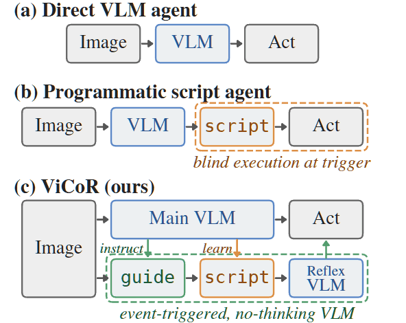
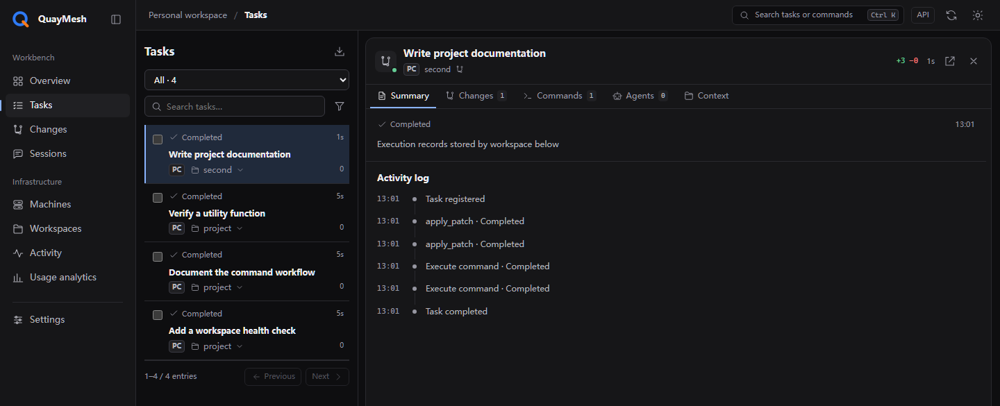

# Qiancheng Zhou

**Shanghai University** &nbsp;·&nbsp; Shanghai, China &nbsp;·&nbsp; [zhou_3721@shu.edu.cn](mailto:zhou_3721@shu.edu.cn)

I research **vision-language agents** for real-time control and **reinforcement learning with verifiable rewards (RLVR)** for reasoning, alongside building **cross-platform developer infrastructure**.

## Selected Research & Systems

### [ViCoR](https://github.com/ershiyidian/ViCoR) — Visual Conditioned Reflexes for Real-Time VLM Agents

*Acting by Intent, Reacting by Sight: Visual Conditioned Reflexes for Real-Time VLM Agents* 
**Qiancheng Zhou**, Wenhua Zhang\* &nbsp;·&nbsp; [Paper (arXiv:2611.18723)](https://arxiv.org/abs/2611.18723) &nbsp;·&nbsp; [Code](https://github.com/ershiyidian/ViCoR)

Bridges deliberate VLM planning and sight-conditioned reaction with fixed model weights: a main VLM explores, maintains structured visual memory, and distills visual triggers and guidance, while an event-triggered no-thinking reflex branch acts in **1.67 s** (**15.4×** faster) and abstains on visual distractors. Achieves **80.4%** mean normalized progress across 17 GameWorld tasks and generalizes across AI GameStore, OmniGameArena (UE5), ARC-AGI-3, and RoboDojo (Isaac Sim).

 

  <a href="https://github.com/ershiyidian/ViCoR">
    <picture>
      <source media="(prefers-color-scheme: dark)" srcset="assets/vicor-dark.png">
      <source media="(prefers-color-scheme: light)" srcset="assets/vicor-light.png">
      
    </picture>
  </a>

 

### [Early Branch Locking](https://github.com/ershiyidian/early-branch-locking) — Solution-Space Narrowing in RLVR

*Locked at the Entrance, Open Inside: Where RLVR Narrows the Solution Space* 
**Qiancheng Zhou**, Ruizhe Li &nbsp;·&nbsp; [Paper (arXiv:2608.29188)](https://arxiv.org/abs/2608.29188) &nbsp;·&nbsp; [Code](https://github.com/ershiyidian/early-branch-locking)

Studies where reinforcement learning with verifiable rewards narrows multi-solution reasoning spaces by grouping valid solutions under solver-defined first-step entrances. Measures solution-space coverage, entrance concentration, access-versus-execution behavior, and controlled prefix-transfer interventions across Countdown and mathematical benchmarks.

 

  <a href="https://github.com/ershiyidian/early-branch-locking">
    <picture>
      <source media="(prefers-color-scheme: dark)" srcset="assets/ebl-dark.png">
      <source media="(prefers-color-scheme: light)" srcset="assets/ebl-light.png">
      
    </picture>
  </a>

 

### [QuayMesh](https://github.com/ershiyidian/QuayMesh) — Cross-Platform Workspace Federation over MCP

Open-Source System (MIT) &nbsp;·&nbsp; [Code](https://github.com/ershiyidian/QuayMesh) &nbsp;·&nbsp; [Release v0.1.0](https://github.com/ershiyidian/QuayMesh/releases/latest) &nbsp;·&nbsp; [Architecture](https://github.com/ershiyidian/QuayMesh/blob/main/docs/ARCHITECTURE.md)

Connects AI assistants to distributed Windows and Linux workspaces through a single Model Context Protocol (MCP) connection. Unifies remote file edits, durable long-running command streams, line-level code diffs, coding agent threads, and direct worker-to-worker file transfers under one web and desktop console.

 

  

 

## Other Open-Source Projects

- **[context-bridge](https://github.com/ershiyidian/context-bridge)** — Local-first repository context packer (Tree-sitter + PageRank) and AST-matched `SemPatch` transaction pipeline for LLMs and MCP clients.
- **[waterclaw-os](https://github.com/ershiyidian/waterclaw-os)** — River-network USV patrol cockpit (Vue 3 + Leaflet GIS) paired with a policy-gated FastAPI and LiteLLM Agent Host.
- **[USV_Visualization_Monitor](https://github.com/ershiyidian/USV_Visualization_Monitor)** — C++17 and Qt/QML desktop client for unmanned surface vehicle serial telemetry, trajectory mapping, and SQLite history.
- **[chuangzhi-he-gauntlet-2026](https://github.com/ershiyidian/chuangzhi-he-gauntlet-2026)** — Frozen-weight LLM text-classification harness benchmark spanning 9 multi-domain OOD, MCQ, and prompt-injection suites.
- **[WakeUp_SHU](https://github.com/ershiyidian/WakeUp_SHU)** — Customized Android timetable client for Shanghai University with academic-affairs integration and 12-period scheduling.
