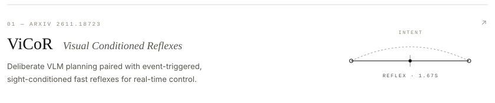
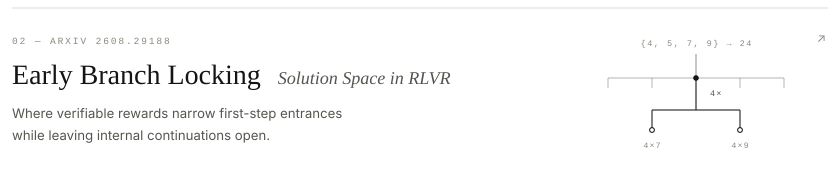
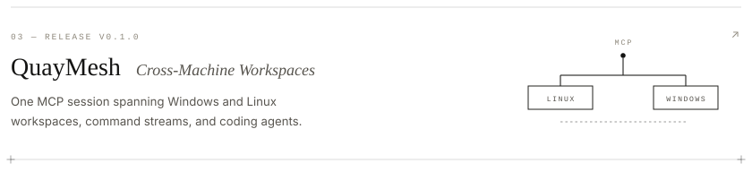

  <picture>
    <source media="(prefers-color-scheme: dark)" srcset="assets/header-dark.svg">
    <source media="(prefers-color-scheme: light)" srcset="assets/header-light.svg">
    
  </picture>

  <a href="https://github.com/ershiyidian/ViCoR">
    <picture>
      <source media="(prefers-color-scheme: dark)" srcset="assets/work-01-dark.svg">
      <source media="(prefers-color-scheme: light)" srcset="assets/work-01-light.svg">
      
    </picture>
  </a>

  <a href="https://github.com/ershiyidian/early-branch-locking">
    <picture>
      <source media="(prefers-color-scheme: dark)" srcset="assets/work-02-dark.svg">
      <source media="(prefers-color-scheme: light)" srcset="assets/work-02-light.svg">
      
    </picture>
  </a>

  <a href="https://github.com/ershiyidian/QuayMesh">
    <picture>
      <source media="(prefers-color-scheme: dark)" srcset="assets/work-03-dark.svg">
      <source media="(prefers-color-scheme: light)" srcset="assets/work-03-light.svg">
      
    </picture>
  </a>

  <a href="mailto:zhou_3721@shu.edu.cn"><picture><source media="(prefers-color-scheme: dark)" srcset="assets/link-mail-dark.svg"><source media="(prefers-color-scheme: light)" srcset="assets/link-mail-light.svg"></picture></a>&nbsp;&nbsp;&nbsp;
  <a href="https://arxiv.org/abs/2611.18723"><picture><source media="(prefers-color-scheme: dark)" srcset="assets/link-vicor-dark.svg"><source media="(prefers-color-scheme: light)" srcset="assets/link-vicor-light.svg"></picture></a>&nbsp;&nbsp;&nbsp;
  <a href="https://arxiv.org/abs/2608.29188"><picture><source media="(prefers-color-scheme: dark)" srcset="assets/link-ebl-dark.svg"><source media="(prefers-color-scheme: light)" srcset="assets/link-ebl-light.svg"></picture></a>&nbsp;&nbsp;&nbsp;
  <a href="https://github.com/ershiyidian/QuayMesh/releases/latest"><picture><source media="(prefers-color-scheme: dark)" srcset="assets/link-qm-dark.svg"><source media="(prefers-color-scheme: light)" srcset="assets/link-qm-light.svg"></picture></a>

