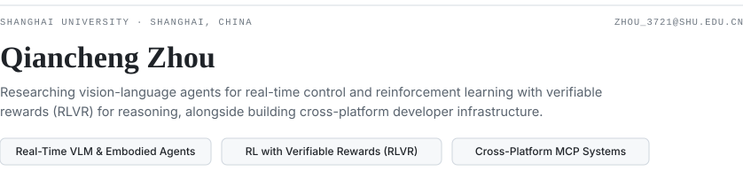
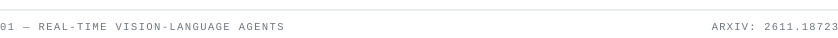
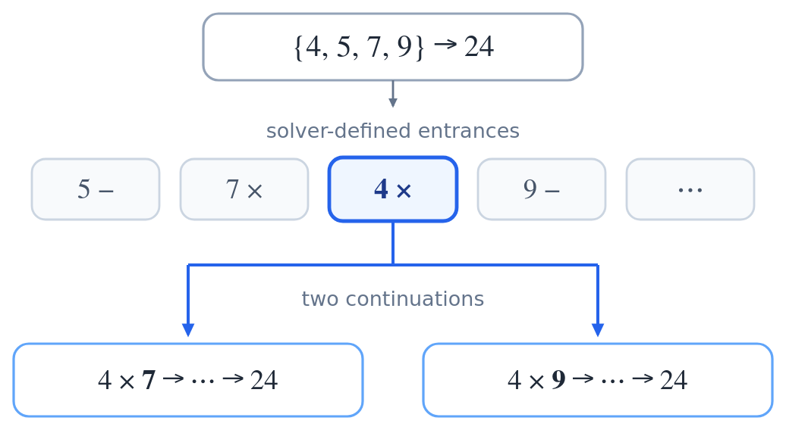
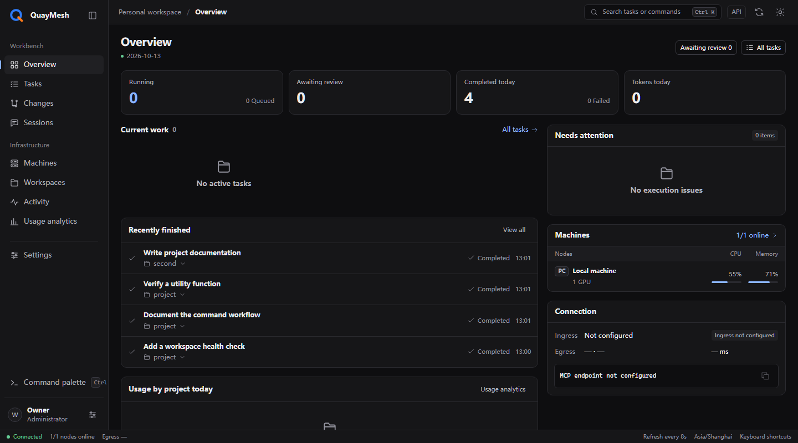

<picture>
  <source media="(prefers-color-scheme: dark)" srcset="assets/header-dark.svg">
  <source media="(prefers-color-scheme: light)" srcset="assets/header-light.svg">
  
</picture>

<picture>
  <source media="(prefers-color-scheme: dark)" srcset="assets/div-01-dark.svg">
  <source media="(prefers-color-scheme: light)" srcset="assets/div-01-light.svg">
  
</picture>

<a href="https://github.com/ershiyidian/ViCoR">
  <picture>
    <source media="(prefers-color-scheme: dark)" srcset="assets/vicor-dark.png">
    <source media="(prefers-color-scheme: light)" srcset="assets/vicor-light.png">
    
  </picture>
</a>

### [ViCoR](https://github.com/ershiyidian/ViCoR)

*Acting by Intent, Reacting by Sight: Visual Conditioned Reflexes for Real-Time VLM Agents* 
**Qiancheng Zhou**, Wenhua Zhang\* &nbsp;·&nbsp; [arXiv:2611.18723](https://arxiv.org/abs/2611.18723) &nbsp;·&nbsp; [Code](https://github.com/ershiyidian/ViCoR)

Couples deliberate VLM planning and visual memory with event-triggered, sight-conditioned fast reflexes (**1.67 s** dispatch, **15.4×** faster), reaching **80.4%** mean progress across 17 GameWorld tasks plus UE5, ARC-AGI-3, and Isaac Sim.

 

<picture>
  <source media="(prefers-color-scheme: dark)" srcset="assets/div-02-dark.svg">
  <source media="(prefers-color-scheme: light)" srcset="assets/div-02-light.svg">
  
</picture>

<a href="https://github.com/ershiyidian/early-branch-locking">
  <picture>
    <source media="(prefers-color-scheme: dark)" srcset="assets/ebl-dark.png">
    <source media="(prefers-color-scheme: light)" srcset="assets/ebl-light.png">
    
  </picture>
</a>

### [Early Branch Locking](https://github.com/ershiyidian/early-branch-locking)

*Locked at the Entrance, Open Inside: Where RLVR Narrows the Solution Space* 
**Qiancheng Zhou**, Ruizhe Li &nbsp;·&nbsp; [arXiv:2608.29188](https://arxiv.org/abs/2608.29188) &nbsp;·&nbsp; [Code](https://github.com/ershiyidian/early-branch-locking)

Measures how verifiable rewards concentrate probability at solver-defined first-step entrances while leaving interior continuations open, with controlled prefix-transfer interventions on Countdown and math benchmarks.

 

<picture>
  <source media="(prefers-color-scheme: dark)" srcset="assets/div-03-dark.svg">
  <source media="(prefers-color-scheme: light)" srcset="assets/div-03-light.svg">
  
</picture>

### [QuayMesh](https://github.com/ershiyidian/QuayMesh)

*One Conversation. Work Across Your Windows & Linux Machines.* 
Open-Source System (MIT) &nbsp;·&nbsp; [Code](https://github.com/ershiyidian/QuayMesh) &nbsp;·&nbsp; [Release v0.1.0](https://github.com/ershiyidian/QuayMesh/releases/latest) &nbsp;·&nbsp; [Docs](https://github.com/ershiyidian/QuayMesh/blob/main/docs/ARCHITECTURE.md)

Federates Windows and Linux workspaces behind a single MCP connection, unifying remote file edits, durable command streams, line-level diffs, coding agents, and worker-to-worker file transfers across web and desktop.

 

<picture>
  <source media="(prefers-color-scheme: dark)" srcset="assets/div-04-dark.svg">
  <source media="(prefers-color-scheme: light)" srcset="assets/div-04-light.svg">
  
</picture>

- **[context-bridge](https://github.com/ershiyidian/context-bridge)** — Tree-sitter & PageRank context packer with AST-matched `SemPatch` transactions for LLMs and MCP.
- **[waterclaw-os](https://github.com/ershiyidian/waterclaw-os)** — River-network USV patrol cockpit (Vue 3 + GIS) and policy-gated FastAPI / LiteLLM Agent Host.
- **[USV_Visualization_Monitor](https://github.com/ershiyidian/USV_Visualization_Monitor)** — C++17 and Qt/QML desktop telemetry, trajectory mapping, and SQLite client for USVs.
- **[chuangzhi-he-gauntlet-2026](https://github.com/ershiyidian/chuangzhi-he-gauntlet-2026)** — Frozen-weight LLM classification harness benchmark across 9 OOD, MCQ, and injection suites.
- **[WakeUp_SHU](https://github.com/ershiyidian/WakeUp_SHU)** — Customized Android timetable client for Shanghai University with academic-affairs integration.
