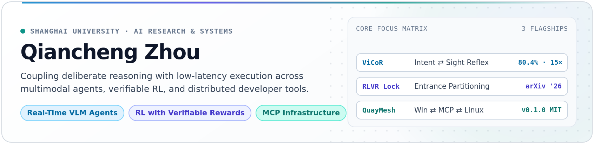
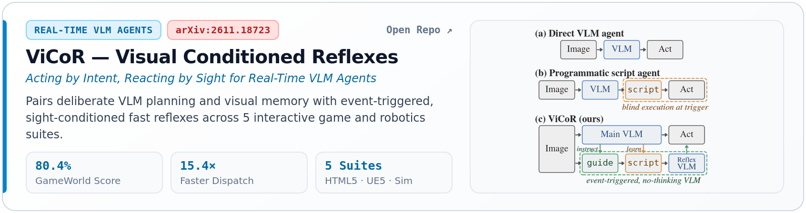
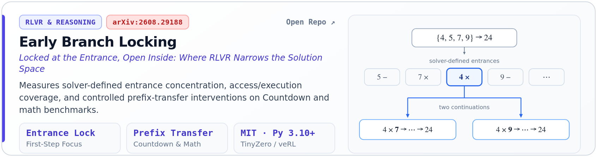
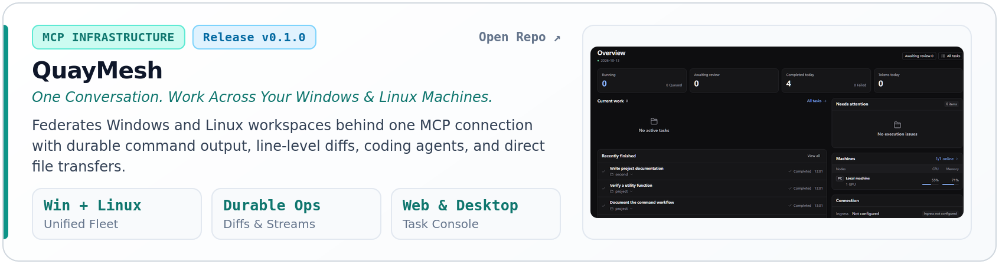
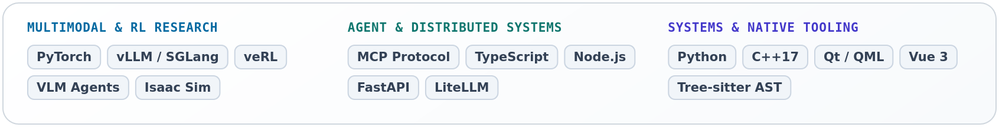

  <picture>
    <source media="(prefers-color-scheme: dark)" srcset="assets/hero-dark.png">
    <source media="(prefers-color-scheme: light)" srcset="assets/hero-light.png">
    
  </picture>

  
  
  
  

### Featured Research & Systems

  <a href="https://github.com/ershiyidian/ViCoR">
    <picture>
      <source media="(prefers-color-scheme: dark)" srcset="assets/card-vicor-dark.png">
      <source media="(prefers-color-scheme: light)" srcset="assets/card-vicor-light.png">
      
    </picture>
  </a>

  <a href="https://github.com/ershiyidian/early-branch-locking">
    <picture>
      <source media="(prefers-color-scheme: dark)" srcset="assets/card-ebl-dark.png">
      <source media="(prefers-color-scheme: light)" srcset="assets/card-ebl-light.png">
      
    </picture>
  </a>

  <a href="https://github.com/ershiyidian/QuayMesh">
    <picture>
      <source media="(prefers-color-scheme: dark)" srcset="assets/card-quaymesh-dark.png">
      <source media="(prefers-color-scheme: light)" srcset="assets/card-quaymesh-light.png">
      
    </picture>
  </a>

### Research & Engineering Stack

  <picture>
    <source media="(prefers-color-scheme: dark)" srcset="assets/stack-dark.png">
    <source media="(prefers-color-scheme: light)" srcset="assets/stack-light.png">
    
  </picture>

<strong>Additional Open-Source Tools &amp; Benchmarks</strong>

 

| Repository | Overview |
| :--- | :--- |
| [**context-bridge**](https://github.com/ershiyidian/context-bridge) | Local-first repository context packer (Tree-sitter + PageRank) and AST-matched `SemPatch` transaction bridge for LLMs & MCP clients |
| [**waterclaw-os**](https://github.com/ershiyidian/waterclaw-os) | River-network USV patrol cockpit (Vue 3 + Leaflet GIS) paired with a policy-gated FastAPI & LiteLLM Agent Host |
| [**USV_Visualization_Monitor**](https://github.com/ershiyidian/USV_Visualization_Monitor) | C++17 and Qt/QML desktop client for unmanned surface vehicle serial telemetry, trajectory mapping, and SQLite history |
| [**chuangzhi-he-gauntlet-2026**](https://github.com/ershiyidian/chuangzhi-he-gauntlet-2026) | Frozen-weight LLM text-classification harness benchmark covering 9 multi-domain OOD, MCQ, and prompt-injection suites |
| [**WakeUp_SHU**](https://github.com/ershiyidian/WakeUp_SHU) | Customized Android timetable client for Shanghai University with academic-affairs integration and 12-period scheduling |

